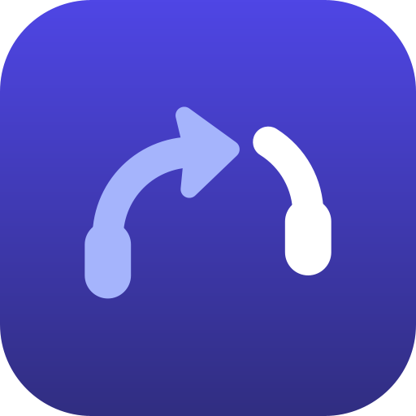

# Branding

## The logo

A pair of headphones whose left half is an **arrow**. It rises from the left earcup and curves over towards the right half, which sits one step up and over: the sound being handed from one device to the other. Lavender is where the sound comes from, white is where it goes.

| | |
|---|---|
| Background | Indigo gradient, `#4F46E5` → `#312E81` (top to bottom) |
| From (arrow half) | Lavender `#A5B4FC` |
| To | White `#FFFFFF` |
| Construction | One line weight (8 of 108) with round ends; both halves on circles of radius 22, the right one offset by (+8, −6). The arrowhead follows the curve where the line enters it, with softly rounded, slightly swept-back corners. |

The app's colours follow the logo: indigo for primary actions and the header, lavender-tinted containers.

It replaced the earlier marks (headphones with a small yellow arrow, then an H with a wave crossbar) in Handoff 0.6.3.

### Generated, not drawn by hand

Every logo file is generated from one geometry by [`tools/IconGen.java`](../tools/IconGen.java): the SVG master and mark, all Android vector drawables, the PNG and ICO files and the Play Store icon. To change the logo, change the constants there and run `java tools/IconGen.java` from the repository root. Don't edit the generated files.

### Checked where it's used

| Where | Size | Result |
|---|---|---|
| README, Play Store icon | 120–512 px | Clear |
| Android launcher (adaptive, circle mask), light and dark wallpapers | 48 dp | Clear; balanced in the mask |
| Android 13+ themed icons (monochrome layer) | 48 dp | Clear in light and dark themes |
| In-app header (mark on a soft backing) | 44 dp | Clear on indigo, light and dark theme |
| Status bar, notifications, Quick Settings tile | 16–24 dp | Reads as headphones with an arrow |
| Windows title bar, taskbar, tray | 16–32 px | Clear on light and dark taskbars |

Rules for using it: keep the proportions and the two tones; on busy backgrounds use the full icon (with its indigo square), and where only one colour is possible use the single-colour mark. It must not be combined with Apple, Google or Bluetooth logos.

## Where the logo lives

Replacing the logo means updating all of these together:

| File | Used for | Notes |
|---|---|---|
| `tools/IconGen.java` | **The source**: geometry and colours; generates every file below | Run `java tools/IconGen.java` |
| `docs/brand/handoff-logo.svg` | Master artwork | Generated |
| `docs/brand/handoff-mark.svg` | Single-colour mark (`currentColor`) | Generated |
| `docs/brand/handoff-logo-512.png` | README header | Generated by `tools/IconGen.java` |
| `docs/brand/handoff-play-icon-512.png` | Play Store icon (512×512, full square; Play applies its own mask) | Generated by `tools/IconGen.java` |
| `app/src/main/res/drawable/ic_launcher_background.xml` | Android adaptive icon, background layer | Gradient |
| `app/src/main/res/drawable/ic_launcher_foreground.xml` | Android adaptive icon, foreground layer | Keep inside the 66 dp safe zone |
| `app/src/main/res/drawable/ic_launcher_monochrome.xml` | Android 13+ themed icon | Single colour |
| `app/src/main/res/mipmap-anydpi/ic_launcher.xml` | Adaptive icon definition (also the round icon) | References the three layers |
| `app/src/main/res/drawable/ic_logo.xml` | Full icon in the app (setup screen) | Generated |
| `app/src/main/res/drawable/ic_mark.xml` | Two-tone mark in the app header (`Components.kt`, `Logo(onBrand = true)`) | Generated |
| `app/src/main/res/drawable/ic_tile.xml` | Quick Settings tile and notification small icon | Must be a single-colour silhouette |
| `desktop/src/main/resources/handoff.ico` | Windows installer, shortcut and taskbar icon | Multi-size ICO, generated by `tools/IconGen.java` |
| `desktop/src/main/resources/handoff.png` | Windows app icon image | Generated |
| `desktop/src/main/resources/handoff-mark.png` | Two-tone mark in the Windows app header | Generated |
| `desktop/src/main/resources/tray.png` | Windows tray icon | Generated; check at 16 and 24 px |
| Play Console | Store icon (512×512) and feature graphic (1024×500) | See [PLAY_STORE.md](PLAY_STORE.md#store-assets-checklist) |

After replacing, check the launcher icon on light and dark wallpapers, the themed icon, the tile and a notification on Android, and the installer, taskbar and tray on Windows.

## Licensing

Both the current logo and the first one are original artwork for this project, released under the project's [MIT License](../LICENSE), as [THIRD_PARTY_NOTICES.md](../THIRD_PARTY_NOTICES.md) says. That grant stays in place for every copy already distributed.

If the project later wants official builds to be distinguishable from forks, a future logo could be published under separate brand terms (for example a short `TRADEMARKS.md` asking forks to use their own name and icon, while the code stays MIT). That is optional: this project puts access first, and there is no plan to restrict the current logo.

## Name

Apple uses "Handoff" as the name of one of its Continuity features. The overlap is a risk to review before a Google Play launch or any marketing. See [PLAY_STORE.md, Name risk](PLAY_STORE.md#name-risk). Handoff is not affiliated with Apple and doesn't work with Apple's Handoff.
